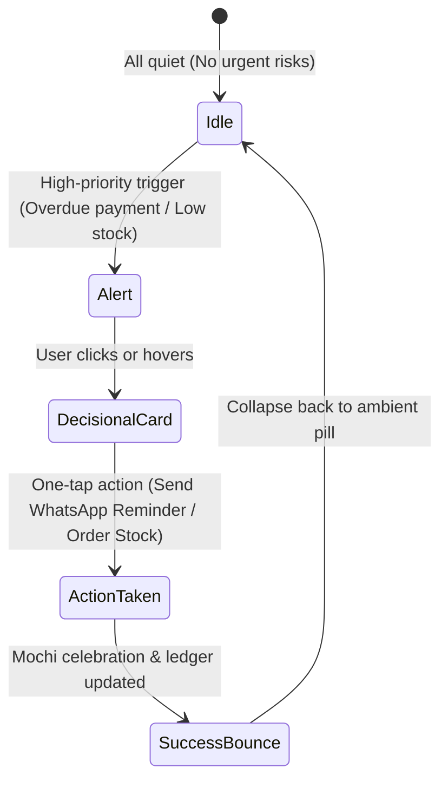

# Palora — Master Product Blueprint & Workshop OS Architecture
### The Operating System for Custom Manufacturing Workshops (Signage, Large-Format Print & Architectural Fabrication)

> **The Meaning of Palora:**  
> **Pal** (The Intelligent Workshop Companion) + **O**perations, **R**outing, **A**ssembling.  
> Transforming fragmented job shops, scattered paper notebooks, and WhatsApp chaos into a unified, profit-protecting **Workshop OS**.

> **Core Product Thesis:** *"No job leaves you with less money than you thought."*  
> The product is **knowing, controlling, and protecting your real profit on every job, from first inquiry to final payment handover**.  
> Built as an **Operating System for Your Workshop** powered by **One Shared Operations Core**, multi-bay process & machine routing, guided assembly heuristics, and data-driven vertical costing packs.

---

## 1. Executive Summary & Category Definition: The Workshop OS

**Palora** is the dedicated **Workshop Operating System (Workshop OS)** purpose-built for bespoke manufacturing workshops in India, launching with **Signage Manufacturing (Phase 1)**, before expanding into commercial display printing and architectural metal fabrication.

### Why "Workshop OS" Instead of Generic ERP:
Generic business software (Salesforce, Zoho, generic ERPs, Excel, or Tally alone) fails custom workshop owners because traditional software was engineered for either **retail commerce** (fixed catalog SKUs, instant POS checkout) or **assembly-line manufacturing** (identical mass-produced units).

A custom manufacturing workshop is fundamentally different: every signboard, channel letter, and architectural facade is a unique, one-off engineering project. Operating a workshop requires a coordinated system that connects:
- **PAL (The Intelligent Companion):** The ambient, event-driven supervisor (Dynamic Island, mobile triage strip, and WhatsApp bot) keeping the owner, estimator, and shop leads proactive without tedious manual data entry.
- **OPERATIONS (The O in Palora):** The commercial and financial heartbeat — Customer & Multi-Site Registry, Margin Leakage Protection, 50/40/10 Milestone Payment Gates, Sheet Stock & Offcut Graveyard Inventory, and Tally/Busy synchronization.
- **ROUTING (The R in Palora):** Dual-dimension routing — (1) **Process Routing** (routing the job through survey $\to$ design proof $\to$ CNC/laser $\to$ bending $\to$ wiring $\to$ welding $\to$ install), and (2) **Machine/Toolpath Routing** (CNC router/laser DXF nesting, cutting kerf, perimeter cutting times, and field crew site routing).
- **ASSEMBLING (The A in Palora):** Physical & electrical assembly guidance — 3D channel letter return bending, acrylic solvent bonding, Samsung LED pitch & density layout, 12V DC wiring loops, 350W SMPS continuous thermal derating (the 80% headroom rule), and structural MS tube frame welding.

### The Realities of the Bespoke Shop Floor:
1. **Dynamic Dimensional Pricing:** Costs calculated per square foot, running inch of perimeter cut, stroke width, and structural frame weight.
2. **Material Wastage & Sheet Yield:** Raw materials come in standard sheets ($8 \times 4\text{ ft}$, $10 \times 5\text{ ft}$). Uncalculated offcuts and poorly nested cuts destroy gross margins.
3. **Multi-Stage Physical Production:** Site survey $\to$ artwork revisions $\to$ CNC routing / laser cutting $\to$ channel letter bending $\to$ LED wiring & power load derating $\to$ structural framing $\to$ scaffolding installation.
4. **Uncollected Balances & Sticky Receivables:** High-value custom orders requiring advance deposits ($50\%$), dispatch milestone releases ($40\%$), and post-installation handover balances ($10\%$), frequently lost across scattered paper notebooks and WhatsApp chats.

---

## 2. The Strategic Reframing: Why "Quote Accuracy" is Too Small to Be the Product

Quoting is where profit gets decided, and it happens multiple times a day. But **fixing quotes alone fixes only a quarter of the problem**:

```
┌────────────────────────────────────────────────────────────────────────┐
│                   THE 27-POINT MARGIN LEAKAGE REALITY                  │
├────────────────────────────────────────────────────────────────────────┤
│ Quoted Apparent Gross Margin: 42.0%                                    │
│   ├── [-6.5%] Quoting & Estimating errors (overlooked load & offcuts)  │  ◄── 24% of Leak
│   ├── [-4.0%] Unbilled artwork revisions & scope creep                 │  ┐
│   ├── [-5.5%] Site installation hazards & unbudgeted crane rentals     │  │  76% of Leak
│   ├── [-3.0%] Untracked offcut graveyard in workshop corners           │  │  Happens AFTER
│   └── [-8.0%] Uncollected final balances & disputed punch-lists       │  │  Quote is Sent!
│ Realized Net Margin: ~15.0%                                            │  ┘
└────────────────────────────────────────────────────────────────────────┘
```

### Why "Accuracy" is Risky as the Headline:
1. **Owner Skepticism:** Owners believe they already know their pricing (*"I've been quoting signs for 20 years"*). Accuracy is hard to prove in a 5-minute demo and easy for an experienced owner to dismiss.
2. **Subjective Baselines:** Rate cards depend on each shop's negotiated distributor terms, operator wages, and local market habits. If software defaults differ by ₹5/RFT, the tool loses credibility.
3. **Visceral Cash vs. Abstract Math:** A bounced ₹30,000 balance or an unbilled client revision is an immediate, concrete rupee loss that keeps the owner awake at night. Collections and payment gating are felt instantly.

**The Real Value Proposition:**  
The product is **Job Profit Protection across the entire lifecycle**:
- **At Quoting:** Reveal true margin (factoring 12% shop overhead, 2D sheet fit, and proper 350W power supply derating) so the job isn't underpriced from Day 1.
- **At Proofing:** WhatsApp approval link + QR-coded Job Cards stop unbilled scope creep and costly re-cuts.
- **At Fabrication:** 2D sheet nesting plans and thermal derating prevent material and hardware rework.
- **At Dispatch & Handover:** Configurable payment milestone gates (50/40/10) ensure the delivery truck doesn't leave the gate until the 40% dispatch milestone is secured.

---

## 3. Product Architecture: Three Capabilities Under One Roof

A typical Indian custom manufacturing workshop already operates three distinct production bays under a single roof:
1. **CNC Router & Laser Bay** (Signage, 3D channel letters, acrylic fabrication).
2. **Wide-Format Eco-Solvent / UV Flatbed Printer** (Vinyl, flex banners, backlit films, ACP direct print).
3. **Welding & Metal Fabrication Bay** (MS tubular frame structures, cantilever brackets, unistrut trusses).

Therefore, **we are not building three separate ERPs**. We are building **One Shared Operations Core** with plug-and-play **Modular Costing Packs**:

```
┌────────────────────────────────────────────────────────────────────────┐
│                   PALORA WORKSHOP OS ARCHITECTURE                      │
│        (Pal Companion + Operations + Routing + Assembling)             │
├────────────────────────────────────────────────────────────────────────┤
│                      ONE SHARED OPERATIONS CORE                        │
│  • Contact CRM & Customer Ledger   • WhatsApp Quotation & Proof Engine │
│  • Configurable Milestone Tracker • Tally Prime / Busy Voucher Export │
│  • Material Inventory & Rate Cards • Pal Guided Operational Heuristics │
├────────────────────────────────────────────────────────────────────────┤
│            MODULAR VERTICAL COSTING PACKS (DATA-DRIVEN ENGINES)        │
│  ┌──────────────────────┬──────────────────────┬─────────────────────┐ │
│  │ 1. SIGNAGE PACK      │ 2. PRINT & DISPLAY   │ 3. FABRICATION PACK │ │
│  │ • Perimeter letters  │ • Roll media sq.ft   │ • MS/SS steel weight│ │
│  │ • LED module density │ • Ink coverage (ml)  │ • Welding RFT labor │ │
│  │ • SMPS load derating │ • Lamination/grommets│ • Structural drawing│ │
│  │ • 2D sheet fit/seams │ • High-volume gang   │ • Civil anchors & PE│ │
│  │ (Phase 1 MVP Wedge)  │ (Costing Pack 2)     │ (Costing Pack 3)    │ │
│  └──────────────────────┴──────────────────────┴─────────────────────┘ │
│                                                                        │
│  ➔ Secondary B2B Network Effect: Cross-shop subcontracting             │
│     (Sign shop outsources printing to print house; fabricator frames) │
└────────────────────────────────────────────────────────────────────────┘
```

---

## 4. Competitor Intelligence: ClarWorks Benchmarking (Sadan & Sarathi)

ClarWorks builds hyper-focused, phone-first vertical operational software for Indian small businesses. Analyzing their flagship products—**Sadan** (construction & builder firm money ledger) and **Sarathi** (fleet and vehicle-hire software)—reveals critical architectural and design principles that Palora directly adopts and enhances:

### 4.1 Insights from Sadan (`clarworks.com/products/sadan`)

| Sadan Core Feature | Sadan User Need | Palora Adaptation for Signage Shops |
|---|---|---|
| **The "Today" Screen** | Instant glance at cash, bank, uncleared cheques, and live net profit the second the owner opens the app. | **Owner "Today" Command Center:** Cash on hand, bank balance, jobs due today, pending quote approvals, and live gross margin. |
| **Project P&L View** | Revenue vs. Purchases vs. Financing costs rolled up to live net profit per project. | **Job P&L:** Exact profit per sign board. Tracks quoted price minus material cost (acrylic, ACP, LEDs), labor, and installation expenses. |
| **Day Book with Cheque Flags** | Every rupee in/out with mode, UTR, and flagged uncleared/bounced cheques. | **Payment Ledger:** Split payments (advance bank transfer + final cash/UPI), with uncleared cheques highlighted so fabrications are not released without clearance. |
| **Units Setup & Status** | Available vs. Allocated vs. Sold units for apartments. | **Job Board Matrix:** Draft Quote $\to$ Approved $\to$ CNC/Laser Cut $\to$ Wiring/Assembly $\to$ Ready for Install $\to$ Installed & Billed. |
| **Phone-First Form Factor** | Made for the owner on the move, with read-only accountant (CA) access. | **Mobile-Responsive Owner Console:** Works seamlessly on mobile for on-site client inspections and shop-floor check-ins. |

### 4.2 Insights from Sarathi (`clarworks.com/products/sarathi`)

| Sarathi Core Feature | Sarathi User Need | Palora Adaptation for Signage Shops |
|---|---|---|
| **Timeline Scheduling** | Visual hour-by-hour fleet timeline showing committed trips vs. sellable free slots. | **Machine & Installation Timeline:** Visual schedule of CNC router/laser cutting tables and field installation crews to prevent double-booking. |
| **Driver Bata & Advance Ledger** | Cash advances, daily bata, and fuel expenses settled from memory without dispute. | **Installer & Labor Advance Ledger:** Site installation allowances, crane/scaffolding rentals, and daily fabricator wage advances tracked cleanly. |
| **Compliance & Expiry Reminders** | Insurance, permits, fitness, PUC expiry alerts before vehicles are impounded. | **Municipal Signage Permit & Site Compliance:** Tracking municipal municipal signage licenses, structural safety certificates, and warranty expirations for clients. |
| **Client & Vehicle Profitability** | Flags which trips, clients, or vehicles lose money. | **Client & Sign Type Profitability:** Flags clients who consistently demand excessive revisions or signs (e.g., complex neon bending) that yield sub-par margins. |

---

## 5. The Commercial Wedge: "Quote-to-WhatsApp-to-Cash"

ERPs fail when they demand extensive shop-floor data entry on Day 1. Palora enters through a high-velocity, low-friction wedge that the business owner can use immediately:

```
[ 1. Smart Quote Builder ] ──► [ 2. WhatsApp Delivery ] ──► [ 3. Client Digital Approval ] ──► [ 4. Milestone Payments ]
  • Enter dimensions & text      • Beautiful branded PDF      • Mobile vector proof view     • 50% Advance via UPI
  • 2D sheet fit calculated      • Itemized quotation link    • 1-tap "Approve & Lock"       • 40% Dispatch Gate
  • 350W SMPS derating safe      • Margin hidden from client  • QR Job Card generated        • 10% Handover Balance
  • True Margin Slider (34%➔42%)
```

**The Pitch to the Owner:**  
*"You quote jobs expecting to make 42% margin, but by the time you pay rent, finish unbilled design changes, and chase the last payment for 60 days, you take home 15%. Palora protects your real profit on every job — from the first quote to the last collected rupee."*

---

## 6. Core Strategy Decisions

### Strategy 1: Don't Replace Tally — Empower It
* Almost all Indian signage shops rely on **Tally Prime, Busy, or Zoho Books** for CA filings and balance sheets.
* Palora positions itself strictly as the **manufacturing operations and shop-floor layer**.
* We export clean accounting vouchers (Sales Invoices, Receipts, Purchase Orders) via XML/JSON directly into Tally/Busy.
* **Indian Statutory Must-Haves Built-In:**
  - Automated GST calculation under **HSN 9405** (Illuminated signs @ 18%).
  - One-click **E-Way Bill** payload generation for dispatches exceeding ₹50,000.
  - **B2B E-Invoicing** readiness for larger manufacturing shops ($>₹5\text{ Cr}$ turnover).

### Strategy 2: Shop Owners Live in WhatsApp
* Quotations, proof approval links, dispatch notifications, and payment reminders travel over official WhatsApp Business APIs.
* Customers don't need to download an app or create an account to approve artwork or pay an advance.

### Strategy 3: Material Distributors as a Distribution Channel
* National and regional substrate distributors (e.g., Maruti Flex Traders, Pioneer Acrylic, Viva ACP) already have hundreds of fabricators buying on credit.
* **The Distributor Partnership:** Ingesting supplier rate cards into Palora keeps shop quotes accurate. In return, distributors recommend Palora to fabricators to streamline order placement and track billings.

### Strategy 4: Grounded Shop-Floor Approvals (No Phantom Machine Locks)
* Chinese CNC routers and fiber lasers run on standalone DSP/Ruida controllers via USB drives; software cannot physically block machine motors.
* When a client approves artwork on WhatsApp, Palora locks the vector (`Job104_v3_APPROVED.dxf`) and generates a physical **Job Card with a verification QR code and timestamp**.
* Operators scan the QR code on mobile before cutting to ensure they cut only the approved design, eliminating costly re-cuts.

---

## 7. UI/UX Paradigm: Fluid Dynamic Island & Ambient Companion

Palora's companion **Pal** and overall interface draw inspiration from Apple HIG motion paradigms, the [Coucou](https://github.com/Louis-CFM/coucou) ambient notch supervisor, and high-data-ink enterprise systems:

```
┌────────────────────────────────────────────────────────────────────────┐
│                        PALORA INTERFACE ARCHITECTURE                   │
├────────────────────────────────────────────────────────────────────────┤
│ 1. AMBIENT NOTCH / DYNAMIC ISLAND COMPANION (Coucou & Novra Grokbot)   │
│    • Resides at the top of the ERP viewport or mobile header.         │
│    • Expressive vector state machine: Idle, Working, Alert, Success.   │
│    • "One in Focus, Rest in Sight" rule: top business emergency in     │
│      full view, secondary alerts collapsed into compact pills.        │
│                                                                        │
│ 2. FLUID ELASTIC MORPHOLOGY (Apple HIG & Fluid Interfaces)            │
│    • Tier 1: Small Pill (36px) — Peripheral glance & micro-metrics.    │
│    • Tier 2: Big Decisional Card (380px) — 2 one-tap actions.          │
│    • Tier 3: Split Bubble — Handles concurrent alerts smoothly.        │
│    • Mass-spring-damper physics (damping 0.82, response 0.38s).        │
│                                                                        │
│ 3. ENTERPRISE MULTI-ROLE DISCIPLINE (The Agency Agents)                │
│    • Strict separation of concerns: Owner (financial/margins),        │
│      Estimator (quoting), Floor Lead (job tracking), Client (proofing).│
│                                                                        │
│ 4. LOCAL PERFORMANCE & MINIMAL ROT                                     │
│    • Fast, responsive UI with zero bloat, snappy cold start, and      │
│      instant client-side quote calculations.                           │
└────────────────────────────────────────────────────────────────────────┘
```

### Meet Pal: The Guided Operational Companion
Pal is **not an LLM chatbot**. It is a deterministic, event-driven supervisor:
* **Mode 1: The Onboarding Build Order** (Add shop hourly rate $\to$ load sheet rate cards $\to$ create first quote).
* **Mode 2: The Daily Triage Strip** ("Quote #340 approved; request token advance" $\to$ "Job #102 ready for install; collect dispatch milestone before truck leaves").
* **Philosophy:** Show only decisions that matter today; offer 1-tap actions; never block the user from working.



---

## 8. The 11 Core Phase 1 Modules Architecture

Derived from our deep comparative mapping of vertical operations (contrasting appointment-centric SaaS against job-centric custom manufacturing), Palora Workshop OS is structured into **11 interconnected modules**:

```
┌─────────────────────────────────────────────────────────────────────────────────────────┐
│                           PALORA 11-MODULE WORKSHOP OS SUITE                            │
├──────────────────────────┬──────────────────────────┬───────────────────────────────────┤
│ 1. Clients & Enquiries   │ 2. Site Survey           │ 3. Smart Quote Builder            │
│    (Front door & Sites)  │    (Hazards & Laser W×H) │    (BOM, 350W SMPS & True Margin) │
├──────────────────────────┼──────────────────────────┼───────────────────────────────────┤
│ 4. Design & Proofing     │ 5. Jobs & Production     │ 6. Crew, Machines & Scheduling    │
│    (WhatsApp approvals)  │    (QR-stamped Job Card) │    (Bays, Installers, Timeline)   │
├──────────────────────────┼──────────────────────────┼───────────────────────────────────┤
│ 7. Payments & Invoicing  │ 8. Materials & Inventory │ 9. Suppliers & Purchases          │
│    (50/40/10 & Tally)    │    (Sheet stock & yield) │    (Distributor rate cards)       │
├──────────────────────────┼──────────────────────────┴───────────────────────────────────┤
│ 10. Owner "Today" Dash   │ 11. Setup & Configuration                                    │
│    (Cash in/out & Triage)│    (Machines, Hourly labor rates, Standard Sign Types)       │
└──────────────────────────┴──────────────────────────────────────────────────────────────┘
```

### Module 1: Clients & Enquiries (The Front Door)
- **Enquiry vs. Client Distinction:** 60%–70% of inbound WhatsApp messages are casual tire-kickers. Enquiries remain transient scratchpads. Only upon formal quoting or token advance is an entity promoted to a permanent Client.
- **The Site Entity:** A single Client (e.g. Kalyan Jewellers or Apollo Pharmacy) has multiple physical store locations. Each Site maintains persistent physical attributes: mounting height, substrate type, power point location, and night installation permissions.
- **Three Contact Personas:**
  1. `Billing POC` (Brand owner / franchisee who pays the invoices).
  2. `Design Approver` (Architect or marketing agency who approves vectors).
  3. `Site POC` (Local store manager who provides key access on installation day).

### Module 2: Site Survey (Field Inspection & Risk Grounding)
*(Subject of dedicated deep-dive in Section 10)*
- Mobile-first measurement capture: Width, Height, Depth, pelmet clearance.
- 6 Fatal Site Hazards checklist (wind load, shutter drop, electrical distance, scaffolding access, night work permits, hollow wall anchors).
- Camera capture with dimensional markup overlay.

### Module 3: Smart Quote Builder (Dimensional BOM & True Margin Engine)
- The heart of Palora. The owner or estimator builds a price in under 60 seconds with 100% margin transparency:
- **Formula 1 (Sheet Fitting Check):** Determines actual standard sheets needed ($8 \times 4\text{ ft}$ or $10 \times 5\text{ ft}$) rather than naive flat square footage.
- **Formula 2 (Letter Perimeter & CNC Cut Time):** Toolpath distance and router feed rates calculate true machine runtime and bit wear.
- **Formula 3 (Letter Face Area & LED Sizing):** Based on letter stroke width and shop density presets (e.g., 20–25 modules / sq.ft).
- **Formula 4 (Continuous Load & Thermal Derating):** Mandatory $1.25\times$ safety factor. A 216W connected load requires a **350W power supply** (at ₹2,900), strictly prohibiting undersized 250W units running at dangerous 86.4% continuous loads.
- **Formula 5 (12% Shop Overhead):** Explicit allocation of workshop rent, electricity, and admin overhead (₹4,536 on a ₹37,800 direct COGS) ensuring selling price covers true cost before applying target margin.
- **True Margin Slider:** Real-time feedback showing exact owner profit in rupees and percentage.

```
┌────────────────────────────────────────────────────────────────────────┐
│ WORKED EXAMPLE: 12 ft × 4 ft 3D LED ACRYLIC SIGNBOARD (ACP TRAY)       │
├────────────────────────────────────────────────────────────────────────┤
│ Material Direct Costs:                                                 │
│ • ACP Tray Face & Returns (64.5 sq.ft gross, 2 sheets 8×4 ft @ ₹110): ₹7,095.00│
│ • Cast Acrylic 3mm Face (18 sq.ft letters @ ₹220/sq.ft):     ₹3,960.00 │
│ • Acrylic Returns/Borders (2.5" depth, solvent bonded):      ₹1,800.00 │
│ • Samsung 3-LED Modules (180 pcs × 1.2W = 216W @ ₹24/pc):    ₹4,320.00 │
│ • MeanWell SMPS (350W derated for 270W peak @ ₹2,900):       ₹2,900.00 │
│ • MS Tubular Sub-Frame (1" square pipe, 48 RFT @ ₹60/RFT):   ₹2,880.00 │
│ • Fasteners, Wiring, Chloroform & Sealant:                   ₹1,245.00 │
├────────────────────────────────────────────────────────────────────────┤
│ Direct Labor & Machine Costs:                                          │
│ • CNC Router Cutting Time (2.5 hrs @ ₹400/hr):               ₹1,000.00 │
│ • Channel Letter Bending & Assembly (2 technicians × 6 hrs): ₹2,400.00 │
│ • Shop Testing & Quality QC (1 hr):                            ₹400.00 │
│ • Site Installation, Scaffolding & Transport:                ₹9,800.00 │
├────────────────────────────────────────────────────────────────────────┤
│ DIRECT COGS (Materials + Direct Labor):                     ₹37,800.00 │
│ SHOP OVERHEAD (12% of Direct Cost — Rent, Utilities, Wear):  ₹4,536.00 │
│ TOTAL BASE PRODUCTION COST:                                 ₹42,336.00 │
├────────────────────────────────────────────────────────────────────────┤
│ TARGET GROSS MARGIN: [ 42.0% ▼ ]                                       │
│ SELLING PRICE (Excl. Tax):                                  ₹72,993.10 │
│ GST (18% under HSN 9405):                                   ₹13,138.76 │
│ FINAL LANDED QUOTE TO CLIENT:                               ₹86,131.86 │
│ TRUE NET PROFIT TO OWNER:                                   ₹30,657.10 │
└────────────────────────────────────────────────────────────────────────┘
```

### Module 4: Design & Proofing (Approval & Scope Lock)
- Vector artwork upload (CDR, AI, PDF, DXF).
- Interactive WhatsApp Proof Approval Link sent directly to `Design Approver`.
- 1-tap "Approve & Lock Vector" timestamped in ledger.
- Scope-change detector: any text or dimension change after approval requires a generated Change Order with cost delta.

### Module 5: Jobs & Production (Shop-Floor Execution)
- Physical **QR-stamped Job Cards** generated upon artwork approval and token advance.
- Operators scan QR card on shop floor to view approved cut file name (`Job104_v3_APPROVED.dxf`), verifying against the USB drive.
- Bay progression tracking:
  `Bay 1: CNC/Laser Cut` $\to$ `Bay 2: Channel Bending` $\to$ `Bay 3: LED Wiring & 2-Hr Bench Test` $\to$ `Bay 4: Metal Sub-Frame Assembly` $\to$ `Bay 5: Packing & Dispatch`.

### Module 6: Crew, Machines & Scheduling
- Visual hour-by-hour timeline for CNC routers, laser cutters, and wide-format printers.
- Installation crew assignment with vehicle and scaffolding allocation.
- Prevents double-booking crews across overlapping customer sites.

### Module 7: Payments, Invoicing & Gating
- Configurable payment milestone templates:
  - Default: **50% Advance** (starts design/material buy) $\to$ **40% Pre-Dispatch** (cleared before truck leaves gate) $\to$ **10% Handover** (collected upon signed installation sheet).
  - Alternative templates: 70/30, 30/50/20, or 100% advance for small retail jobs.
- Uncleared cheque and pending UPI flags block the Dispatch Gate in the software.
- Accounting synchronization: Export XML/JSON vouchers directly into Tally Prime / Busy.

### Module 8: Materials & Inventory
- Sheet stock management ($8 \times 4\text{ ft}$ ACP, acrylic, foam board).
- Reusable offcut graveyard registry: tracks offcuts $>2 \times 2\text{ ft}$ so small letter jobs don't consume virgin sheets.
- Reel & hardware tracking: LED modules, power supplies, adhesives, vinyl rolls.

### Module 9: Suppliers, Rate Cards & Purchase Orders
- Distributor rate cards (Maruti Flex, Pioneer, Viva ACP, MeanWell distributors).
- Purchase order generator matching BOM requirements.
- Cash discount tracking (e.g., 2% discount for 7-day payment to distributors).

### Module 10: Owner "Today" Command Dashboard
- Financial triage strip: Cash on hand, bank balance, uncleared cheques, receivables overdue $>30$ days.
- Operational bottleneck triage: Jobs stuck in bays, installations delayed by rain/permits.
- Pal Assistant action cards with 1-tap WhatsApp relays.

### Module 11: Setup & Configuration
- Shop hourly overhead and machine operating cost parameters.
- Standard sign type templates (3D Front-Lit, Back-Lit Halo, Acrylic Sandwich, Pylon, ACP Groove Box).
- User roles & permissions (Owner, Estimator, Prepress Designer, Floor Lead, Installer).

---

## 9. Master-Skiller Pipeline Execution DAG

Using the `master-skiller` framework, Palora is built through a rigorous 6-phase engineering DAG:

```
[Phase 1: Domain Modeling & Formula Grounding]
  │── Dimensional pricing & sheet nesting algorithms
  │── SMPS continuous load & thermal derating rules
  │── ClarWorks Sadan/Sarathi operational heuristics
  ▼
[Phase 2: UX Architecture & Motion Design System]
  │── Apple HIG Spring motion tokens & Dynamic Island morphology
  │── High-data-ink dark-mode theme, tabular numbers, responsive layout
  │── Ambient "Pal" state machine (Rive / SVG Canvas)
  ▼
[Phase 3: Core Operations Implementation (The 11 Modules)]
  │── Front Door, Site Registry & Survey Engine (Modules 1–2)
  │── Smart Quote Builder & True Margin Slider (Module 3)
  │── WhatsApp Proofing & QR Job Cards (Modules 4–5)
  │── Production, Scheduling & Inventory (Modules 6, 8, 9)
  │── Payments, Milestone Gating & Tally Sync (Module 7)
  │── Owner "Today" Command Center (Module 10)
  ▼
[Phase 4: Pal Guided Assistant Engine]
  │── Event bus listening to ERP state mutations (quotes, jobs, payments)
  │── Priority ranking queue ("One in focus, rest in sight")
  │── One-tap action dispatcher (WhatsApp relay, status toggle, re-order)
  ▼
[Phase 5: Testing, Hardening & Statutory Compliance]
  │── Margin calculation validation (prevent negative margin quotes)
  │── Two-decimal currency precision & Tally XML voucher schema validation
  │── E-Way bill & HSN 9405 GST tax audits
  ▼
[Phase 6: Pilot Partner Onboarding & Field Validation]
  │── Onboard 5 real signage shop design partners
  │── 10-job historical audit comparing actual spend vs. Palora quote
  │── Calibrate default shop density and overhead sliders
```

---

## 10. Design Partner Discovery Program & 4 Core Hypotheses

We do not launch publicly to anonymous users. We partner deeply with **5 established signage workshops**:
1. **The Discovery Pilot:** Sit with the shop owner and estimator.
2. **The 10-Job Historical Audit:** Run their last 10 completed jobs through Palora's Smart Quote Builder.
3. **The Margin Delta Test:** Compare Palora's calculated cost against what the shop actually spent.
4. **Validation Goals:**
   - Calibrate the shop's default LED module density slider (18 vs. 24 vs. 30 / sq.ft).
   - Validate the SMPS thermal derating multiplier ($1.20\times$ vs. $1.25\times$).
   - Confirm overhead allocation percentage ($10\%$ to $15\%$).
   - Test WhatsApp quote delivery and milestone payment collection speed.

### Four Working Hypotheses to Validate:
* **Hypothesis 1 (Software Ecosystem):** 80%–90% of local prepress operators use CorelDRAW due to CAM software compatibility.
* **Hypothesis 2 (Margin Erosion):** Realized net margin drops by 8%–15% from quoted gross margin due to unbudgeted overhead and electrical sizing deltas.
* **Hypothesis 3 (WhatsApp Velocity):** Quotes delivered via WhatsApp with 1-tap approval close 40% faster than email/PDF attachments.
* **Hypothesis 4 (Payment Compliance):** Halting installation dispatch until the 40% milestone is cleared reduces 60-day receivables by $>50\%$.

---

## 11. Roadmap Document Consolidation Note
*This document (`palgen.md`) is the authoritative, single source of truth for the Palora Workshop OS product. It supersedes and absorbs all contents of `palgen_comprehensive_analysis.md`, unifying competitor benchmarks, UX motion paradigms, engineering DAGs, and the complete 11-module architecture.*
